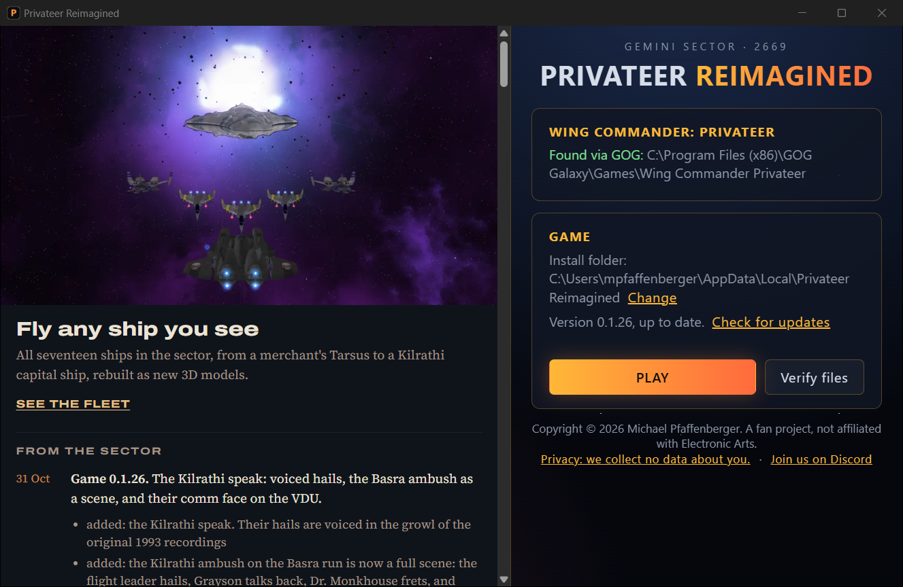

# Privateer Reimagined launcher (Tauri v2)

A thin UI over [`crates/prl-core`](../crates/prl-core). Every rule (ownership gate,
release-key check, one operation at a time) lives in `src-tauri/src/lib.rs`; `ui/` only
renders state.



```
ui/              index.html + style.css + app.js (no bundler; embedded at build time)
src-tauri/       Rust backend, tauri.conf.json, capabilities, icons
```

## Run it

```bat
cd launcher
npm install
npx tauri dev
```

Debug builds accept two overrides, so you can test against a local store (e.g. one made
with `prl build` + `prl publish --to <folder>`):

| Variable | Effect | In release builds |
|---|---|---|
| `PRL_CDN` | store URL or local folder (default `https://cdn.privateer-reimagined.com`) | honoured (signatures are still checked) |
| `PRL_PUBLIC_KEY` | trust a scratch signing key | **ignored**: only the compiled-in key (`crates/prl-core/src/keys.rs`) is trusted |

## News panel

The left half of the window shows <https://privateer-reimagined.com/launcher/>, which is
`site/launcher/index.html` in this repo. Edit that page and merge, and every launcher shows the
change the next time it starts; no launcher release needed (#44). The buttons and every rule
stay compiled into the launcher.

- The panel is `<iframe sandbox="allow-same-origin allow-popups">`: no scripts, forms or
  top-level navigation, and no access to the launcher's commands. Keep the page script-free.
- Links with `target="_blank"` open in the player's browser (http/https only, via the
  `on_new_window` hook in `lib.rs`); other links navigate inside the panel.
- The site lets only the launcher frame that page (`site/_headers`, `frame-ancestors`), and
  the launcher's CSP frames only the site (`frame-src`, checked by a unit test).
- If the page doesn't answer within 4 s (offline), the panel shows a built-in message.

Settings live in `%APPDATA%\com.privateer-reimagined.launcher\launcher.json` (the
Privateer folder found, and the install folder). The default install folder is
`%LOCALAPPDATA%\Privateer Reimagined`.

## Build the installer

```bat
npx tauri build
```

Produces `target\release\bundle\nsis\Privateer Reimagined_<version>_x64-setup.exe`
(per-user install, no admin prompt) and, beside it, its updater signature `<exe>.sig`.

## Release a new launcher (it updates itself, #48)

Installed launchers (0.3.0 and later) read `https://cdn.privateer-reimagined.com/launcher/latest.json`
at start and again when the player comes back to the window (Tauri's `tauri://focus`; at most
hourly, #57), offer a newer version in a banner, and on **Update** download it, check its signature
against the key compiled into them, run the installer passively and restart.

1. Bump the version in `src-tauri/tauri.conf.json`, `src-tauri/Cargo.toml` and `package.json`
   (a unit test checks they agree).
2. Build with the updater key in the environment (it's a file, never commit or print it):
   ```powershell
   $env:TAURI_SIGNING_PRIVATE_KEY = [IO.File]::ReadAllText("$env:USERPROFILE\.prl\launcher_updater.key")
   $env:TAURI_SIGNING_PRIVATE_KEY_PASSWORD = ""
   npx tauri build
   ```
3. **macOS** (can't be built on Windows): push to `main` (or run the `macos` workflow by hand);
   its artifact holds `Privateer Reimagined_<v>_aarch64.dmg` and `..._aarch64.app.tar.gz`.
   Download it and sign the archive here, so the updater key never leaves this machine:
   ```powershell
   npx tauri signer sign -f "$env:USERPROFILE\.prl\launcher_updater.key" -p "" "<path>\Privateer Reimagined_<v>_aarch64.app.tar.gz"
   ```
4. From `publisher/`, with the R2 variables set (Windows and/or macOS, same version):
   `uv run prl upload-launcher --installer <exe> --macos-archive <app.tar.gz> --macos-dmg <dmg> --version <v> --notes "<one line>" --to r2`.
   It uploads each file and its `.sig` (immutable names), then points `latest.json` at them
   last. One feed lists every platform for one version; a newer version never carries another
   platform's older build. It refuses unsigned files and an older version than the feed has.
5. Point the website's download buttons at the new files, **and** update the SHA-256s printed
   under "Open it" and the version in the note. Then `python tools/check_site_download.py`
   (and `--live` after the deploy): it downloads what the button links to and compares it with
   the printed hash (#62).

**The updater key** (`%USERPROFILE%\.prl\launcher_updater.key`; public half in
`tauri.conf.json` `plugins.updater.pubkey`) is separate from the game's release key. Back it up
with the release key. If it's lost, installed launchers can't be updated any more: players would
have to download a launcher built with a new key by hand.

**Before the first public release:**

1. `uv run prl keygen` and paste the public key into `crates/prl-core/src/keys.rs`;
   until then the launcher refuses every release.
2. Code-sign the installer, or Windows SmartScreen will warn players.
3. Replace the placeholder icon (`src-tauri/app-icon.png`, then `npx tauri icon`).
